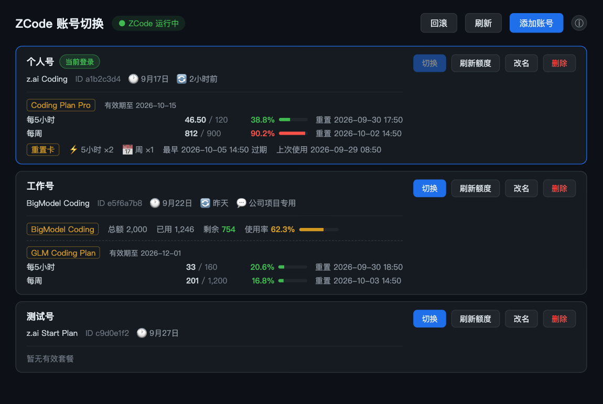

# zcas — ZCode 账号无感切换工具

登录一次，自由切换。把 ZCode 的多个账号登录态保存为快照，一键切换，
免去多账号之间反复走 OAuth + 验证码的繁琐流程。

**GUI（桌面应用）+ CLI 双形态，共享同一套核心库**。单二进制、零依赖，
账号数据全部存在本机（`~/.zcas/`），不上传任何服务器。

> 实现参考：[smartlizi/zcode-account-switcher](https://github.com/smartlizi/zcode-account-switcher)

## 功能特性

- **一键切换**：自动关闭 ZCode → 备份当前登录态 → 写入目标账号 → 重启 ZCode，秒级完成
- **系统托盘**：关闭窗口即最小化到状态栏（可设为直接退出或每次询问）；托盘菜单支持恢复窗口、启动 ZCode、一键切换账号并实时查看各账号 5 小时额度进度条；单实例运行，重复启动自动唤起已有窗口
- **添加账号两种方式**：
  - **OAuth 添加**：工具内发起浏览器登录（Z.ai 中国 / z.ai 全球 / BigModel 旧渠道），登录完成自动入库，全程不触碰当前登录态；国内账号走 ZCode 3.18.2 同款「服务端发起 + 轮询检测」流程，全程无需粘贴回调链接；授权过程有分步进度 + 轮询心跳提示，不会「卡住不知道成没成」
  - **抓取当前登录**：在 ZCode 客户端里登录后，一键把当前账号存为快照
- **同账号自动归并**：同一账号重新验证或换渠道授权后，按 UserID 自动并入既有账号条目（名称/备注/历史保留），不会产生重复账号
- **额度总览**：账号列表自动展示每个账号的套餐与剩余额度，支持手动刷新
- **快照保鲜**：切换离开时自动把当前账号的最新 token 回写到它的快照，防 refresh token 过期搁浅
- **回滚兜底**：每次切换前自动整文件备份，误操作一键回到切换前的登录态
- **字段级快照**：只保存账号相关字段，切换时合并写回，不影响你的编辑器偏好与自定义 provider 配置
- **版本与更新**：「关于」弹窗内查看版本并检查 GitHub 新版本（菜单栏 About / 托盘「关于」均可打开）

## 界面



账号一行一个：名称、ID、渠道、保存时间、套餐与剩余额度一目了然；
操作按钮（切换 / 刷新额度 / 改名 / 删除）固定在每行右上角；
当前登录的账号带「当前登录」徽标与高亮边框。
（截图中为演示数据）

## 安装

### 下载安装包（推荐）

| 平台 | 文件 | 安装方式 |
|---|---|---|
| macOS（Apple Silicon） | `zcas-x.y.z-macos-arm64.pkg` | 双击安装，自动装 App + CLI |
| macOS（Apple Silicon） | `zcas-x.y.z-macos-arm64.dmg` | 拖拽安装（仅 GUI） |
| Windows x64 | `zcas-x.y.z-windows-amd64-installer.exe` | 双击安装器 |
| Windows ARM64 | `zcas-x.y.z-windows-arm64-installer.exe` | 双击安装器 |
| Linux ARM64 | `zcas-x.y.z-linux-arm64.tar.gz` | 解压后 `sudo ./install.sh` |

> ⚠️ **平台验证状态**：macOS 版已实机完整验证；Windows 版已在真实机器验证核心链路（账号识别 / Z.ai（中国）OAuth 添加 / 切换 / 托盘 / 额度），**z.ai（全球）渠道的浏览器回调与 BigModel（旧）渠道在 Windows 上尚未完整验证**（虚拟机中回调会被 Parallels 等宿主应用共享拦截，可粘贴回调链接兜底；BigModel 登录页曾出现验证码发不出，疑似官方侧问题）；Linux 版仅通过编译打包。如遇问题欢迎提 Issue。
>
> 首次打开提示"无法验证开发者"（macOS）或 SmartScreen 拦截（Windows）时，
> 选择右键打开 / 仍要运行即可（个人分发未做 Apple 公证与微软签名）。
> Linux 运行 GUI 需要 `sudo apt install libwebkit2gtk-4.1-0`。

### 从源码构建

```bash
git clone <本仓库地址> && cd zcas
make release          # 一键出全平台安装包到 dist/（Windows 需 brew install makensis；Linux 需 Docker）

# 只构建本机可用的形态：
go build -o zcas ./cmd/zcas        # CLI
cd app && wails build              # GUI（需安装 wails CLI v2.16+）
```

替换应用图标：`scripts/make-icon.sh /path/to/新图标.png` 后重新 `make release`。

## 使用

### GUI

打开「ZCS」：

1. **添加账号** → 选「OAuth 登录新账号」（渠道按本机 ZCode 版本自动引导）：
   - **Z.ai（中国）**：ZCode 3.18.2 起国内账号的官方登录方式（zchat.z.ai）。
     工具发起后自动检测授权完成（最长约 5 分钟），**无需粘贴任何链接，全平台一致**；
     等待期间有分步进度条、轮询心跳和授权标识比对提示。
     ⚠ 需 ZCode ≥ 3.18.2——旧版客户端不认 zchat 渠道账号，切换后会掉登录页；
     工具检测到旧版 ZCode 时会自动禁用该渠道并默认选中 BigModel，
     切换 zchat 账号到旧版 ZCode 前也会二次确认
   - **z.ai（全球）**：浏览器登录后自动跳回工具完成（macOS）；
     Windows 已实现 `zcode://` 协议接管自动回调（个别虚拟机环境可能被宿主拦截，
     此时把地址栏链接粘贴回工具即可）；Linux 需粘贴回调链接
   - **BigModel（旧）**：3.18 之前的国内登录渠道；ZCode 未升级到 3.18.2 的机器请用此渠道添加账号
2. 或先在 ZCode 客户端登录，再用「抓取当前登录」入库
3. 点账号右侧「切换」，ZCode 自动重启并进入目标账号

菜单栏结构：**ZCS**（About ZCS / Quit ⌘Q）、**Tools**（Add Account ⌘N / Launch ZCode / Refresh ⌘R）、
**Settings**（Options…）、**About**（Windows 下为下拉项）。
设置入口共三处：菜单栏 Settings ▸ Options…、顶栏 ⚙ 按钮、托盘菜单「设置」。

### 系统托盘

点窗口关闭键时（macOS / Windows）：

- 首次会弹窗询问「最小化到托盘」还是「直接退出」，可记住选择
- 之后想改，随时在「设置」（顶栏 ⚙ / 菜单栏 Settings / 托盘菜单）里切换，立即生效

托盘图标菜单：

- 状态行：ZCode 运行状态 + 当前账号
- **恢复窗口**（macOS 托盘态下应用会从 Dock 隐藏，只留状态栏图标；点击 Dock 图标也会恢复窗口）
- **启动 ZCode** / **账号额度**：账号与额度直接平铺在主菜单（不进二级子菜单），
  每个账号一行，5 小时额度进度条与主界面同款配色
  （macOS 为账号名下方的整行圆角进度条；Windows 受原生菜单限制为账号行左侧的彩色小进度条图标），
  当前账号以绿色圆点标记；点击其他账号直接切换（自动重启 ZCode）；
  额度走主界面/托盘共享的查询结果，打开菜单自动补查（15 秒节流），后台低频保活
- **设置** / **关于** / **退出**

退出路径：托盘菜单「退出」、macOS Dock 右键退出 / Cmd+Q 均为真退出
（真退出时自动归还 `zcode://` 协议、停掉后台保活巡检）；窗口红叉关闭按设置走（询问 / 托盘 / 退出）。

> Linux 托盘为 no-op（暂无环境验证），关闭键行为仍可用（最小化=仅隐藏窗口）。

### CLI

```bash
zcas                       # 当前登录账号 + 已保存账号列表
zcas capture --name 主账号     # 把当前 ZCode 登录态存为快照
zcas add --provider zai_cn # 浏览器 OAuth 添加新账号（中国新版，自动检测完成；不影响当前登录）
zcas add --provider zai    # 同上（全球渠道；默认，回调链接需粘贴）
zcas use 2                 # 切换账号（自动关闭并重启 ZCode）
zcas quota                 # 查当前账号额度；zcas quota 2 查指定账号
zcas rollback              # 回滚到切换前的登录态
zcas rm / rename / kill / launch
```

## 工作原理（简述）

ZCode 的登录态由 `~/.zcode/v2/` 下两份文件构成：`credentials.json`（OAuth token、
用户档案等，字段以 `enc:v1` 或 `enc:v2` 前缀做 AES-256-GCM 加密）和 `config.json`
（明文 JWT apiKey 落在 provider 槽位）。zcas 把这两份文件中的**账号相关字段**
抽取为快照；切换时先备份现场、再把目标账号的字段合并写回，随后重启客户端。

OAuth 登录渠道（逆向自官方客户端，随 ZCode 3.18.2 同步）：

- **Z.ai（中国）`zai_cn`**：官方 3.18.2 起新流程——本地生成 poll token，
  `POST zcode.z.ai/api/v1/oauth/cli/init` 发起授权流，浏览器在 zchat.z.ai 完成登录后，
  工具轮询 `cli/poll/<flow_id>` 直接拿到 token 集合（无授权码、无回调依赖，全平台体验一致）；
  BigModel 关联凭据存为 `oauth:linked_bigmodel`。
- **z.ai（全球）`zai`**：授权码流程，`redirect_uri` 用官方 3.18.2 的
  `zcode.z.ai/app/oauth/login` 中转页；token 交换后与官方一致把 zai token 换发 business token 入库。
- **BigModel（旧）**：3.18 之前的国内登录页，仅供存量账号重新授权。

额度取数与官方客户端同源、按可用性依次回退：coding-plan api-key →
`oauth:linked_bigmodel`（zchat 登录时服务端自动绑定的 BigModel 凭据，查 5 小时/每周双窗口）
→ oauth access_token → `zcode.z.ai/api/v1/mcp/usage` 聚合窗口。

两种加密格式对应两把不同的密钥，都在本机：

- `enc:v1`：ZCode 早期格式，密钥由本机信息（系统/家目录/用户名）派生。
- `enc:v2`：ZCode 3.18+ 的默认格式，密钥由 ZCode 随机生成后存放在 **macOS 钥匙串**
  （服务名 `ZCode Credential Encryption`）。zcas 解密时需向钥匙串读取这把密钥，
  因此 macOS 会弹一次授权框——详见下方[钥匙串授权说明](#钥匙串授权说明macos)。

zcas 读取时用对应密钥在本机解密、写回时重新加密，**所有操作均在本机完成，不联网上传**。
zcas 写回的仍是 `enc:v1`，ZCode 下次启动会自动升级为 `enc:v2`，两者兼容。

## 钥匙串授权说明（macOS）

首次识别当前登录账号时，macOS 可能弹出钥匙串授权框（形如「"zcas" 想使用您钥匙串中
存储的机密信息」）。这是正常且必要的一步，请放心，下面把边界说清楚：

- **读的是什么**：只读取 ZCode 自己生成、存放在你本机钥匙串里的**一把加密密钥**
  （钥匙串服务名 `ZCode Credential Encryption`）。ZCode 3.18+ 用这把密钥加密你的账号
  凭据（`enc:v2`），zcas 必须拿到它，才能在本机解密、识别并切换**你自己的**账号。
- **不读什么**：不读取你的开机/登录密码，不读取其它 App 或网站的钥匙串内容，
  也**不会新建、修改、删除任何钥匙串项**——只对上面这一项做「读取」。
- **数据去向**：这把密钥和解密出的凭据，只在本机内存和你的 `~/.zcas/` 目录里使用，
  **不会上传到任何服务器，zcas 也没有自己的后端**。程序唯一的联网行为是「查额度」和「查更新」：
  查额度只发往 ZCode / Z.AI 官方接口，请求里带的是**你自己账号的 token**——它的作用只是让官方接口
  确认「是本人在查本账号的额度」，zcas 不会把这个 token 发给任何第三方；查更新只发往 GitHub。
- **为什么会弹**：这把密钥是 ZCode 存进去的，系统默认只信任 ZCode 本体。zcas 是另一个 App，
  macOS 按安全规矩替你把这一次访问弹出来征求授权，而不是让 zcas 悄悄读走。
- **怎么处理**：点「**始终允许**」即可——同一版本之后不再弹；升级到新版本时可能再弹一次
  （个人分发未做 Apple 开发者签名，每次构建的程序指纹会变，属正常现象，不是异常或攻击）。

> 如果你不希望 zcas 访问钥匙串，点「拒绝」即可：此时 zcas 无法解密 `enc:v2` 凭据，
> 表现为「当前登录账号识别不出、当前账号额度卡片为空」，但已保存账号之间的切换、
> 用快照查询额度等功能不受影响（快照是 zcas 自己用 `enc:v1` 存的，不依赖钥匙串）。

## 安全机制

- 切换前强制关闭 ZCode（SIGTERM → 超时 SIGKILL），防止客户端回写覆盖
- 每次切换前整文件备份到 `~/.zcas/.last/`，写入失败自动回滚
- 回写保鲜前做防污染校验（账号一致性 + token 可解密），旧快照留 `.bak`
- 全部写入原子化（先 `.tmp` 后 rename）

## 数据位置

| 路径 | 内容 |
|---|---|
| `~/.zcode/v2/` | ZCode 客户端登录态（本工具读写） |
| `~/.zcas/accounts/` | 账号快照（`<id>.meta.json` + `<id>.snap.json`） |
| `~/.zcas/.last/` | 切换前备份（回滚用） |
| `~/.zcas/config.json` | 可热更新配置：billing 请求参数、`closeAction`（关闭窗口行为）、`autoLaunchZCode`（启动时自动拉起 ZCode，默认开） |
| `~/.zcas/oauth-debug.log` | OAuth 登录流程诊断日志（排查授权失败用） |

## 卸载

- **macOS**：删除 `/Applications/ZCS.app` 和 `/usr/local/bin/zcas`
- **Windows**：开始菜单卸载程序（uninstall.exe 会询问是否同时删除账号数据目录 `~/.zcas`，
  选「否」保留数据，重装后可继续使用）；CLI 删除解压目录
- **Linux**：删除 `/usr/local/bin/zcas`、`/usr/local/bin/zcas-gui` 及对应桌面文件
- 账号数据：卸载器未删除时手动 `rm -rf ~/.zcas`（删除前请确认 ZCode 里已登录你要保留的账号）

## 致谢

- 实现参考：[smartlizi/zcode-account-switcher](https://github.com/smartlizi/zcode-account-switcher)
- 桌面框架：[Wails](https://wails.io)

## 免责声明

本工具仅供学习研究和个人使用，与 Z.AI / 智谱官方无任何关联。
请遵守相关服务条款，账号安全由使用者自行负责。
